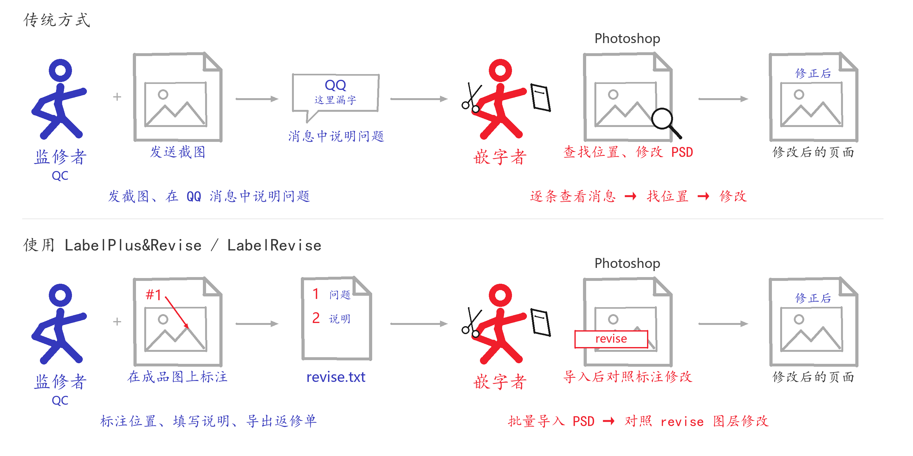
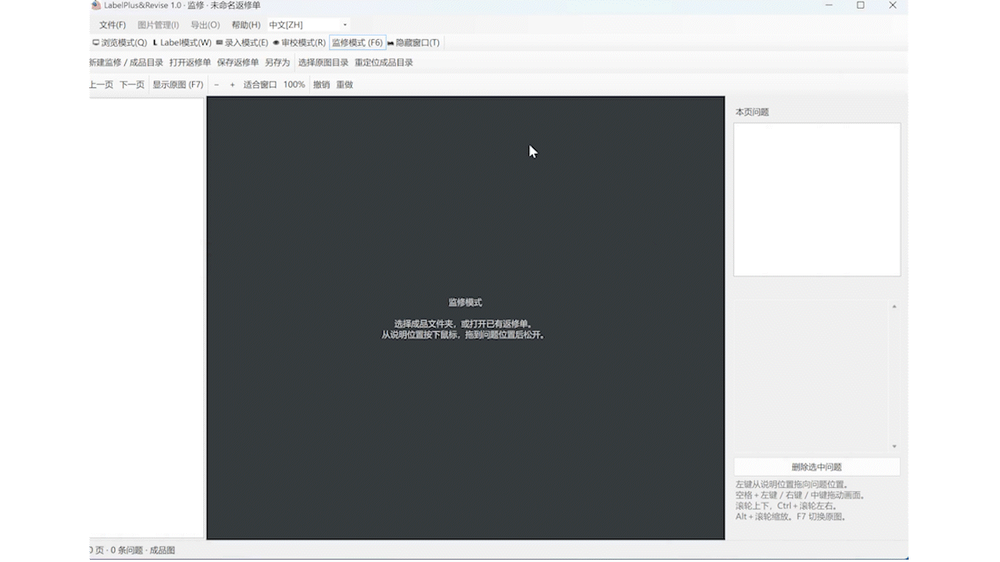
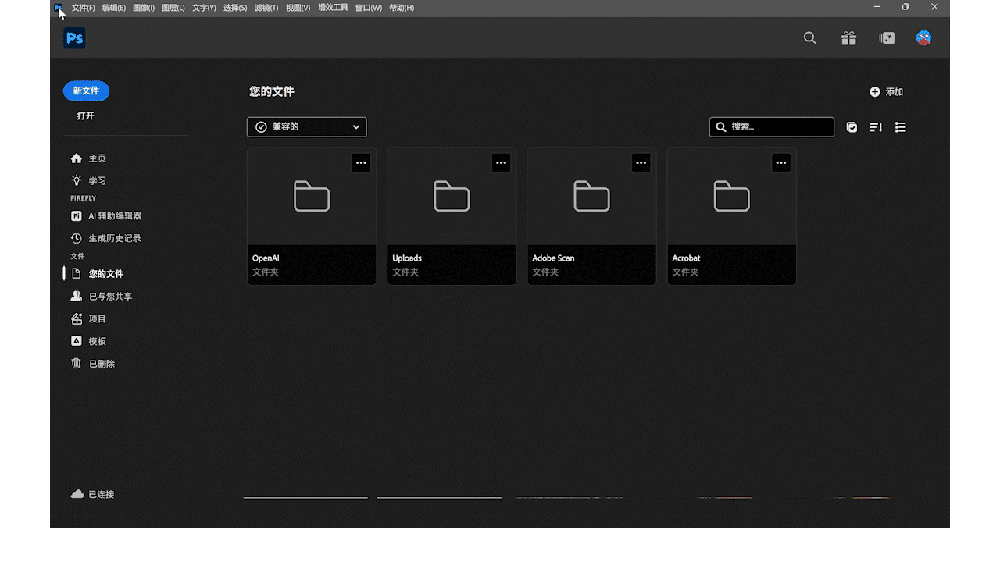

# LabelPlus&Revise / LabelRevise

## 目录

- [写在前面](#写在前面)
- [简介](#简介)
- [两个版本](#两个版本)
- [下载与运行](#下载与运行)
- [如何使用](#如何使用)
  - [对于监修者](#对于监修者)
  - [对于嵌字者](#对于嵌字者)
  - [快速上手](#快速上手)
  - [常用操作](#常用操作)
- [项目来源与许可](#项目来源与许可)

**漫画翻译交接与嵌字返修辅助工具**

基于 [LabelPlus](https://noodlefighter.com/label_plus/) 增加监修（QC）功能：在嵌字完成的成品图上标注问题，导出返修单，再通过 Photoshop 脚本把标注放到对应 PSD 中，供嵌字者查看和修改。

[下载 1.0](https://github.com/Dryiceee/LabelPlus-Revise/releases/tag/v1.0) · [上游 LabelPlus](https://github.com/LabelPlus)

## 写在前面

这个项目的灵感，来自群友做的一款很 fancy 的监修软件。它可以直接打开 PSD、与图层交互，还能把监修意见导出为一张长图，作为返修单交给嵌字者。

不过，讨论中也有人指出：对嵌字者来说，拿着长图逐条找位置修改，与通过 QQ 接收截图和说明的交接方式仍然很相近。有个形容很生动——像是在做一份题目和选项分别印在纸张正反面的完形填空，需要不停地翻来翻去。

我觉得，问题出在修改内容和查看返修要求分属两个地方：嵌字者在 Photoshop 里修图，却要去 QQ 或另一张长图里查看哪里需要修改，再自己找到对应的位置。因此，我想解决的是让嵌字者在 Photoshop 里就能直接看到问题位置和修改说明。

这与“翻译—嵌字”的交接问题很相似，而 LabelPlus 已经给出了很好的思路：翻译者在软件里写译文，嵌字者通过脚本将译文导入 Photoshop 中的对应位置。

于是，我想把同样的思路用到“监修—嵌字”上：监修者标注问题、导出返修单，嵌字者再将标注导入 PSD，在实际修改的地方直接查看返修要求。所以有了这个项目。

## 简介

LabelPlus 为翻译者和嵌字者提供了看图写译文、导出文本和导入 Photoshop 的交接方式。本项目在此基础上，增加了嵌字完成后的监修与返修交接。

传统的 QC 流程通常是：监修者通过 QQ 逐条发送截图，并在聊天消息中说明问题；嵌字者再逐条查看截图和文字消息，找到对应的页面和位置，进行修改。

使用本工具，监修者可以直接在成品图上用箭头指出问题、填写修改说明，并集中保存为一份 `revise.txt`。嵌字者将返修单批量导入 PSD 后，就能在对应画面上查看这些问题，再进行返修。



## 两个版本

| 版本 | 包含功能 | 适合谁 |
| --- | --- | --- |
| **LabelPlus&Revise** | 保留 LabelPlus 的浏览、Label、录入和审校模式，增加监修模式；PS 脚本支持译文导入和返修导入 | 需要译文交接和返修功能的工作组 |
| **LabelRevise** | 仅保留监修标注和 PS 返修导入，启动后直接进入返修界面 | 只需要 QC 与嵌字返修的用户 |


## 下载与运行

前往 [Releases](https://github.com/Dryiceee/LabelPlus-Revise/releases) 下载所需版本的 ZIP，完整解压后运行其中的 EXE。

- **LabelPlus&Revise**：运行 `LabelPlus&Revise.exe`，按 **F6** 进入监修模式。
- **LabelRevise**：运行 `LabelRevise.exe`，直接开始监修。

运行环境为 Windows 10/11、.NET Framework 4.8；返修导入需要支持 JSX 脚本的 Photoshop。请保留解压后的配套文件，尤其是 EXE 旁的 `.exe.config`。

## 如何使用

### 对于监修者

在软件中打开成品图，用箭头指出需要修改的位置，并在右侧填写问题说明。需要对照原图时，可以在同一画布中切换原图和成品图。

排版，重绘等问题，都可以按实际位置标注，最后集中交付为一份返修单。



### 对于嵌字者

在 Photoshop 中选择返修单和 PSD 文件夹，脚本按同名文件批量导入标注。每页的箭头、编号和说明会合并为一个名为 `revise` 的普通像素图层，便于在原 PSD 上对照查看。




### 快速上手

#### 1. 整理文件

下面沿用萌翻网站导出的默认目录结构，并补充后续使用的成品图目录 `finished/` 和监修生成的返修单 `revise.txt`，方便软件和脚本自动匹配：

```text
漫画工程/
├─ images/          原图，可选
├─ finished/        嵌字完成后导出的成品图
│  ├─ 001.png
│  └─ 002.png
├─ output/          对应的 PSD
│  ├─ 001.psd
│  └─ 002.psd
├─ revise.txt       监修保存的返修单
└─ translations.txt 
```

成品图文件夹可以使用其他名称。成品图与 PSD 按不含后缀的文件名对应，例如 `001.png` 对应 `001.psd`；请使用同尺寸的成品图和 PSD。用于对照的原图也应同名、同尺寸。

#### 2. 监修标注并交付

1. 点击 **“新建监修 / 成品目录”**，选择成品图文件夹。
2. 软件会自动查找同级的 `images` 原图文件夹；找不到时，可手动选择，也可以取消并继续监修。
3. **在箭头尾部按住左键，拖向问题位置后松开**。松开处就是箭头头部。
4. 在右侧填写问题说明。点击“本页问题”中的条目后，可以直接输入；说明框也可以拖动调整位置。
5. 保存为 `revise.txt`，交给嵌字者。

#### 3. 在 Photoshop 中导入返修单

1. 选择 **“文件 → 脚本 → 浏览”**，运行对应脚本：
   - LabelRevise：`PS-Script/LabelRevise.jsx`。
   - LabelPlus&Revise：`PS-Script/LabelPlus&Revise_Revise.jsx`。也可以运行 `LabelPlus&Revise.jsx`，再选择返修导入。
2. 选择 `revise.txt`。脚本会自动查找返修单同目录下的 `output`；找不到时，手动选择 PSD 文件夹。
3. 确认文件对应关系，点击 **“生成 revise”**。
4. 对照 `revise` 图层修改原有内容，完成后手动保存 PSD。

脚本只匹配所选 PSD 文件夹的当前一层。重复导入时，原有的 `revise` 图层会改名并隐藏；脚本不自动保存或关闭 PSD。

修改完成后，可以重新导出成品图，交给监修者复查。

### 常用操作

以下操作适用于监修画布：

| 操作 | 快捷键 / 鼠标 |
| --- | --- |
| 上下移动 | 滚轮 |
| 左右移动 | Ctrl＋滚轮 |
| 缩放画面 | Alt＋滚轮 |
| 抓手拖动画面 | 空格＋左键，也支持右键或中键拖动 |
| 切换原图 / 成品图 | F7 |
| 保存返修单 | Ctrl＋S |
| 另存为 | Ctrl＋Shift＋S |
| 撤销 / 重做 | Ctrl＋Z / Ctrl＋Y |
| 上一页 / 下一页 | 左右方向键或 PageUp / PageDown |
| 删除选中问题 | Delete |
| 从说明编辑框返回画布 | Ctrl＋Enter |

## 项目来源与许可

本项目基于 Noodlefighter 及贡献者开发的 [LabelPlus](https://github.com/LabelPlus/LabelPlus) 和 [LabelPlus PS-Script](https://github.com/LabelPlus/PS-Script) 修改。原项目介绍及帮助入口见 [LabelPlus 官网](https://noodlefighter.com/label_plus/)。

上游代码和第三方组件的版权、许可声明予以保留。具体条款见仓库的 `LICENSE.txt`、各组件中的声明及发行包内的 `LICENSES`；完整对应源码随发行包提供。
